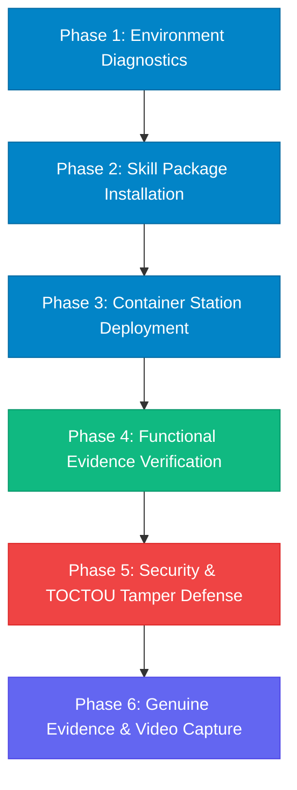

# VaultPilot AI — Round 2 Physical UGREEN NAS Test Protocol

**Document Status:** Official Hardware Validation Procedure  
**Author:** UGREEN NAS Integration Specialist & QA Automation Lead  
**Scheduled Testing Window:** November 22–28, 2026 (Subject to Organizer Hardware Provisioning)  
**Target Hardware:** UGREEN AI NAS (`iDX6011 Pro` / UGOS Pro / x86_64)  
**Repository:** `/home/osama/VaultPilot-AI`

---

## 1. Hardware Testing Objectives & Guarantees

This protocol governs the on-device verification of VaultPilot AI once physical UGREEN NAS units or remote hardware instances are assigned for Round 2 evaluation.

**Strict Testing Invariants:**
1. Zero simulated results will be presented as hardware results.
2. Original NAS storage volumes will be accessed strictly through read-only kernel mounts.
3. Every test step will produce timestamped terminal logs and genuine system screenshots.

---

## 2. Test Execution Workflow



---

## 3. Detailed Step-by-Step Execution Plan

### Phase 1: Environment Diagnostics & Hardware Profiling
- **Command:**
  ```bash
  uname -a
  cat /etc/os-release
  lscpu | grep "Model name\|Architecture\|CPU(s)"
  free -h
  df -h /volume1
  ```
- **Validation Criteria:** Record CPU architecture (x86_64), available RAM ($\ge 8\text{ GB}$), and filesystem type (`btrfs` with data scrub or `ext4`).

### Phase 2: Skill Package Installation in UGOS / Uliya
- **Command:**
  ```bash
  # Deploy validated Skill ZIP to Uliya skill directory
  cp /home/osama/VaultPilot-AI/dist/vaultpilot-skill.zip /var/ugreen/skills/
  # Test entry-point recognition via WorkBuddy / Uliya CLI
  uliya skill list
  uliya skill inspect vaultpilot
  ```
- **Validation Criteria:** Uliya daemon recognizes `vaultpilot` entry-point with 0 schema warnings.

### Phase 3: Container Station Deployment
- **Deployment File:** [`docs/ROUND2_UGREEN_INTEGRATION_PLAN.md`](file:///home/osama/VaultPilot-AI/docs/ROUND2_UGREEN_INTEGRATION_PLAN.md#41-production-docker-composeyml)
- **Execution:**
  ```bash
  docker compose -f docker-compose.nas.yml up -d
  docker ps | grep vaultpilot
  ```
- **Validation Criteria:** Both backend and frontend containers start cleanly with `read_only: true` and unprivileged UID `1000:1000`.

### Phase 4: Functional Evidence Verification (Mode C Activation)
- **Preparation:** Seed `/volume1/NGO_Projects/Health_Aid_2026/` with synthetic PDF invoices, purchase orders, and bank slips.
- **API Execution:**
  ```bash
  curl -X POST "http://localhost:8000/api/v1/investigations/run" \
    -H "Content-Type: application/json" \
    -H "X-Auditor-Key: auditor-lead-nas-token" \
    -d '{
      "project_id": 1,
      "folder_path": "/volume1/NGO_Projects/Health_Aid_2026",
      "title": "Physical NAS Live Evidence Audit"
    }'
  ```
- **Validation Criteria:**
  - `PhysicalNASStorageProvider` discovers files on real `/volume1/` mount.
  - Streaming SHA-256 digests computed without loading entire files into memory.
  - 3-Way reconciliation identifies matching transactions and discrepancies.

### Phase 5: Security, TOCTOU & Tamper Defense
- **Simulated File Tampering:**
  ```bash
  # Attempt concurrent write while file is being hashed
  python3 scripts/test_hardware_toctou.py /volume1/NGO_Projects/Health_Aid_2026/invoices/INV-01.pdf
  ```
- **Validation Criteria:** System detects modification timestamp delta and aborts acquisition with `NASFileMutationError`. Original file remains intact due to read-only mount.

### Phase 6: Genuine Evidence & Video Capture
- Capture full-screen screenshots of:
  1. UGOS Pro desktop showing physical NAS model number and system status.
  2. UGOS Container Station showing `vaultpilot` containers running healthy.
  3. VaultPilot web client running on the NAS local IP address.
  4. Real-time terminal logs of Uliya agent orchestrating `file-agent`.
