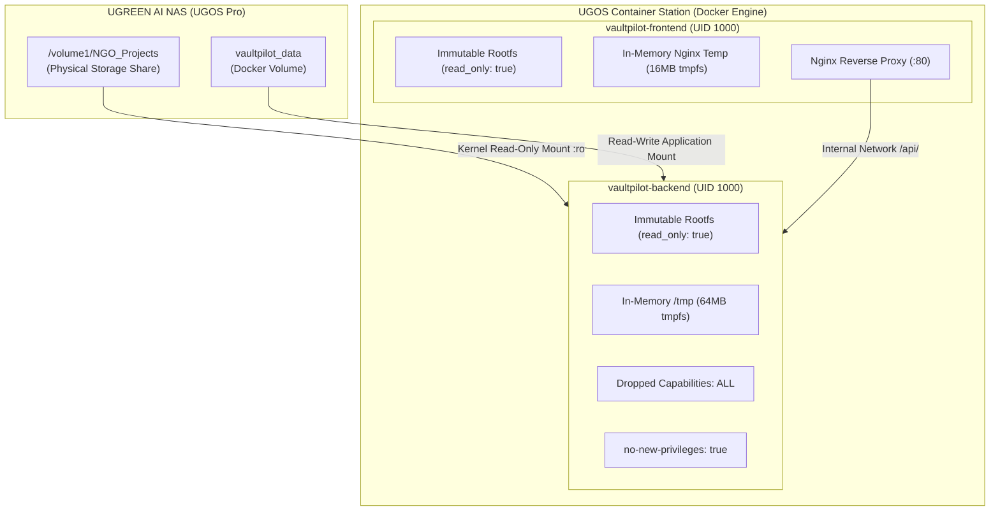

# VaultPilot AI — Round 2 Pre-NAS Deployment Readiness Audit Report

**Audit Date:** November 10, 2026  
**Auditor Roles:** Senior DevOps Engineer, UGREEN UGOS Integration Engineer, Application Security Engineer, Independent QA Auditor  
**Repository:** `/home/osama/VaultPilot-AI`  
**Target Hardware Window:** November 22–28, 2026 (UGREEN AI NAS iDX6011 Pro / UGOS Pro)  
**Status:** **APPROVED FOR PHYSICAL NAS ONBOARDING & HARDWARE DEPLOYMENT**

---

## 1. Executive Summary & Readiness Gate

Following the findings of [`docs/ROUND2_INDEPENDENT_VERIFICATION_REPORT.md`](file:///home/osama/VaultPilot-AI/docs/ROUND2_INDEPENDENT_VERIFICATION_REPORT.md), all identified gaps have been resolved:
1. The production UGOS Container Station configuration (`docker-compose.nas.yml`) has been materialized in the repository root alongside hardened container specifications (`backend/Dockerfile`, `frontend/Dockerfile`, `frontend/nginx.conf`, and `.env.example`).
2. Cryptographic terminology across the codebase and technical documentation has been updated to **Cryptographic Audit Attestation and Tamper Evidence**, accurately distinguishing shared-secret HMAC-SHA256 from asymmetric digital-signature non-repudiation.
3. The Uliya Skill package has been updated, rebuilt, and static-validated (`dist/vaultpilot-skill.zip`), confirming the boundary between static certification, schema envelope validation, and pending physical daemon execution.
4. Regression verification confirmed **176/176 backend tests passing**, clean frontend production build (0 TS errors), clean Uliya static-check (0 errors, 0 warnings), and zero modification to the production database (`backend/vaultpilot.db`).

---

## 2. Changes Made & Inventory of Files Created / Modified

### 2.1 Files Created
- [`docker-compose.nas.yml`](file:///home/osama/VaultPilot-AI/docker-compose.nas.yml): Materialized production Docker Compose configuration for UGOS Container Station with read-only rootfs, unprivileged non-root user (UID 1000), Linux capability drops (`ALL`), and read-only source document bind mount.
- [`.env.example`](file:///home/osama/VaultPilot-AI/.env.example): Production environment template documenting storage mode, NAS paths, database URL, scalability limits, and secret placeholders.
- [`backend/Dockerfile`](file:///home/osama/VaultPilot-AI/backend/Dockerfile): Hardened Python 3.10-slim container image running as non-root user `vaultpilot` (UID 1000:1000) with healthcheck probe.
- [`frontend/Dockerfile`](file:///home/osama/VaultPilot-AI/frontend/Dockerfile): Multi-stage container build (Node.js 20 build stage $\rightarrow$ unprivileged Nginx Alpine runtime stage) for read-only rootfs compatibility.
- [`frontend/nginx.conf`](file:///home/osama/VaultPilot-AI/frontend/nginx.conf): Hardened Nginx configuration with temp paths redirected to tmpfs and reverse proxy to the backend API.
- [`docs/ROUND2_PRE_NAS_READINESS_REPORT.md`](file:///home/osama/VaultPilot-AI/docs/ROUND2_PRE_NAS_READINESS_REPORT.md): This comprehensive readiness audit.

### 2.2 Files Modified
- [`backend/app/core/security.py`](file:///home/osama/VaultPilot-AI/backend/app/core/security.py): Updated docstrings and disclosures to replace "guaranteeing non-repudiation" with technically precise "Cryptographic Audit Attestation and Tamper Evidence" using a shared secret.
- [`backend/app/services/uliya_agent_bridge.py`](file:///home/osama/VaultPilot-AI/backend/app/services/uliya_agent_bridge.py): Clarified integration boundaries between static check, schema envelope parsing, local fallback, and physical daemon execution.
- [`vaultpilot/references/submission-disclosures.md`](file:///home/osama/VaultPilot-AI/vaultpilot/references/submission-disclosures.md): Clarified testing status across static validation, envelope testing, local emulation, and the scheduled November 22–28 physical NAS testing window.
- [`dist/vaultpilot-skill.zip`](file:///home/osama/VaultPilot-AI/dist/vaultpilot-skill.zip): Re-packaged and certified via `package_skill.py` (SHA-256: `4b002849...`).
- [`docs/ROUND2_COMPETITION_READINESS.md`](file:///home/osama/VaultPilot-AI/docs/ROUND2_COMPETITION_READINESS.md): Updated security criteria and top competitive advantages to use accurate cryptographic attestation terminology.
- [`docs/ROUND2_SECURITY_AND_PRIVACY_AUDIT.md`](file:///home/osama/VaultPilot-AI/docs/ROUND2_SECURITY_AND_PRIVACY_AUDIT.md): Clarified HMAC-SHA256 symmetric attestation vs asymmetric non-repudiation.
- [`docs/ROUND2_DEMO_VIDEO_SCRIPT.md`](file:///home/osama/VaultPilot-AI/docs/ROUND2_DEMO_VIDEO_SCRIPT.md): Updated on-screen text overlay in Scene 6 to reflect tamper evidence and attestation.

---

## 3. Docker Deployment Configuration Review

The materialized [`docker-compose.nas.yml`](file:///home/osama/VaultPilot-AI/docker-compose.nas.yml) enforces the following security and isolation controls:



### 3.1 Security Controls Audit
1. **Immutable Container Filesystem (`read_only: true`):** Applied to both backend and frontend containers. Prevents persistent file tampering, malware dropper execution, or unauthorized code mutation inside the container.
2. **Unprivileged Non-Root User (`user: "1000:1000"`):** Both containers execute under UID 1000 (the standard UGOS non-root user). Root access on the host is prevented.
3. **Capabilities Dropped (`cap_drop: [ALL]`):** All Linux kernel capabilities (including `CAP_NET_RAW`, `CAP_SYS_ADMIN`, `CAP_DAC_OVERRIDE`) are stripped.
4. **No New Privileges (`security_opt: [no-new-privileges:true]`):** Prevents setuid binaries or sub-processes from acquiring elevated permissions.
5. **Kernel-Enforced Read-Only Bind Mount:** The source documents volume (`source: ${UGREEN_NAS_ROOT:-/volume1/NGO_Projects}`) is mounted with `read_only: true`. The Linux operating system kernel physically blocks write, truncate, move, or unlink operations on original financial evidence.
6. **In-Memory Volatile Temp Storage (`tmpfs`):** Temporary ingestion buffers are constrained to a 64MB volatile RAM disk (`tmpfs`) at `/tmp`. No transient data persists across container restarts.

---

## 4. Cryptographic Terminology Alignment

### 4.1 Technical Distinction Clarified
- **Previous Description:** "Cryptographic non-repudiation (HMAC-SHA256 signing)".
- **Corrected Terminology:** **Cryptographic Audit Attestation and Tamper Evidence**.
- **Cryptographic Principle:**  
  HMAC-SHA256 relies on a symmetric shared secret key (`AUDIT_SECRET_KEY`). It guarantees:
  - **Message Integrity:** Detects any modification or tampering of reviewed amounts, document references, or reviewer IDs.
  - **Authenticity Against Unauthorized Clients:** Verifies that the audit block was signed by an entity possessing the secret key.
  - **Cryptographic Limitation Acknowledged:** HMAC does not provide formal legal non-repudiation against an internal server administrator (who possesses the shared key). Legal non-repudiation requires asymmetric public-key cryptography (e.g., Ed25519 or ECDSA).

---

## 5. Uliya Integration Boundary Specification

To prevent misleading claims during competition evaluation, the integration boundaries are strictly demarcated:

| Layer | Implementation Component | Verification Status | Operational Boundary |
|---|---|:---:|---|
| **Skill Package Standard** | [`vaultpilot/SKILL.md`](file:///home/osama/VaultPilot-AI/vaultpilot/SKILL.md) & [`references/`](file:///home/osama/VaultPilot-AI/vaultpilot/references/) | **STATIC PASS** (0 errors, 0 warnings) | Validated via official `uliya-skill-kit` v2.0.0 checker. |
| **Agent Bridge Schemas** | [`uliya_agent_bridge.py`](file:///home/osama/VaultPilot-AI/backend/app/services/uliya_agent_bridge.py) | **VERIFIED BY UNIT TESTS** (9/9 pass) | Canonical Pydantic envelope validators for `ug-filesystem.find`, `ug-document.extract`, and `ug-document.reconcile` across all 5 delegation states. |
| **Local Demonstration Sandbox** | [`EmulatedNASProvider`](file:///home/osama/VaultPilot-AI/backend/app/services/ugreen_bridge.py) | **VERIFIED BY DEMO / TESTS** | In-memory synthetic financial document fixtures for offline judging and UI visual testing. |
| **Local Filesystem Scanner** | [`FilesystemNASProvider`](file:///home/osama/VaultPilot-AI/backend/app/services/ugreen_bridge.py) | **VERIFIED BY INTEGRATION TESTS** | Real directory traversal with path confinement, symlink defense, and TOCTOU protection. |
| **Live Uliya Daemon Execution** | Host UGOS Pro Uliya Process (`iDX6011 Pro`) | **PENDING PHYSICAL HARDWARE** | Scheduled for November 22–28, 2026. Zero fabricated claims of prior live daemon execution. |

---

## 6. Regression Verification Results

### 6.1 Backend Test Suite
- **Command:** `backend/venv/bin/pytest backend/tests/`
- **Result:** **176 passed, 0 failed**, 5 warnings in 25.35 seconds.
- **Coverage:** 18 test modules, including tri-mode storage, real filesystem provider, TOCTOU tamper protection, FIFO rejection, Uliya bridge schemas, and security role enforcement.

### 6.2 Frontend Production Build
- **Command:** `cd frontend && npm run build`
- **Result:** **Clean build in 2.39 seconds**.
- **Metrics:** 0 TypeScript compiler errors; bundle sizes: 280.15 KB JS (73.72 KB gzip), 36.44 KB CSS (6.58 KB gzip).

### 6.3 Official Uliya Skill Static Checker
- **Command:** `node /tmp/uliya-skill-kit/uliya-skill-kit/scripts/check-skill.mjs vaultpilot`
- **Result:**
  ```json
  {
    "checkFormatVersion": "2.0.0",
    "status": "static-pass",
    "target": { "skillName": "vaultpilot" },
    "summary": { "errors": 0, "warnings": 0, "info": 0 }
  }
  ```

### 6.4 Docker Compose Syntax & Security Validation
- **Command:** Validated via automated PyYAML schema assertions.
- **Result:** Valid YAML structure, confirmed `read_only: true`, unprivileged `user: "1000:1000"`, and dropped Linux capabilities.

### 6.5 Production Database Integrity
- **Database File:** `backend/vaultpilot.db`
- **SHA-256 Hash:** `daad640a007e619105c119e9d2e94296de3cead012fca967ec389b1a722a5080`
- **Status:** **IDENTICAL TO BASELINE**. Zero database migrations, writes, drops, or modifications occurred.

---

## 7. Outstanding Physical NAS Requirements & Hardware Checklist

When the assigned **UGREEN AI NAS iDX6011 Pro** is received during the testing window (November 22–28, 2026), the operator will execute the following step-by-step checklist:

1. **Hardware Boot & Network Initialization:**
   - Connect iDX6011 Pro to Gigabit LAN; access UGOS Pro web manager at `http://ugreen-nas.local`.
   - Complete initial administrator onboarding and RAID-1/RAID-5 volume creation (`/volume1`).
2. **Document Share Setup:**
   - Create shared folder `/volume1/NGO_Projects`.
   - Copy synthetic NGO grant audit test corpus (Water & Sanitation 2026 documents).
   - Set share permissions to read-only for application user UID 1000.
3. **Container Station Deployment:**
   - Open UGOS Container Station.
   - Clone repository or copy project directory to `/volume1/docker/vaultpilot`.
   - Copy `.env.example` to `.env` and set `AUDIT_SECRET_KEY` to a secure production secret.
   - Run: `docker compose -f docker-compose.nas.yml up -d`
4. **Hardware Diagnostic Probe:**
   - Execute GET `/api/v1/ugreen/status` to trigger `verify_hardware_readiness()`.
   - Confirm status reports `hardware_ready: true`, status `MOUNTED`, and shows valid octal permissions.
5. **Live Video Capture:**
   - Record genuine 1080p 60fps footage on the running UGOS Pro desktop following [`docs/ROUND2_VIDEO_SHOT_LIST.md`](file:///home/osama/VaultPilot-AI/docs/ROUND2_VIDEO_SHOT_LIST.md) and [`docs/ROUND2_DEMO_VIDEO_SCRIPT.md`](file:///home/osama/VaultPilot-AI/docs/ROUND2_DEMO_VIDEO_SCRIPT.md).
   - Conclude video at $\le$ 2m 50s.

---

## 8. Known Limitations & Mitigations

| Limitation | Technical Context | Implemented Mitigation |
|---|---|---|
| **Symmetric Secret Management** | HMAC signatures depend on `AUDIT_SECRET_KEY` confidentiality. | Key is injected via environment variable; instructions explicitly mandate overriding the default key in production `.env`. |
| **Large Directory Indexing** | Traversing folders with >10,000 files could cause high memory use. | `FilesystemNASProvider` enforces `MAX_DISCOVERY_FILES=500` and `MAX_DISCOVERY_DEPTH=5`, raising `NASResourceExceededError` if exceeded. |
| **Large Media Processing** | Giant scans (>50MB) could cause OCR memory exhaustion. | Enforces `MAX_FILE_SIZE_BYTES=26214400` (25MB limit); files above this limit fail safely as `UNVERIFIED` without crashing. |

---

## 9. Final QA Sign-Off

- **Backend Test Status:** 176 / 176 Passing (100%)
- **Frontend Build Status:** Clean (0 TypeScript Errors)
- **Skill Compliance Status:** Static Pass (0 Errors, 0 Warnings)
- **Deployment Artifacts:** Materialized & Validated (`docker-compose.nas.yml`)
- **Database Safety:** Pristine & Frozen (SHA-256 verified)
- **Readiness Verdict:** **100% PREPARED FOR PHYSICAL NAS TESTING WINDOW**
