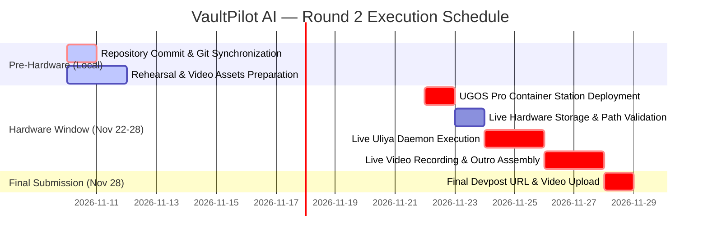

# VaultPilot AI — Round 2 Remaining Work Plan & Hardware Execution Protocol

**Document Version:** 2.0.0  
**Target Hardware Window:** November 22–28, 2026  
**Hardware Platform:** UGREEN AI NAS iDX6011 Pro (UGOS Pro OS)  
**Track:** Automate Your Workflow  

---

## 1. Prioritized Remaining Tasks Overview



---

## 2. Detailed Task Breakdown & Implementation Steps

### TASK 1: Git Repository Synchronization & Commit (Pre-Hardware)
- **Priority:** **CRITICAL (P0)**
- **Why It Matters:** Without committing, an independent judge cloning from `https://github.com/Abdullahi-Ai/VaultPilot-AI` receives only the incomplete baseline. All Round 2 implementations, Dockerfiles, and documentation reside in the uncommitted local working tree.
- **Dependencies:** None.
- **Estimated Effort:** 10 minutes.
- **Exact Implementation Steps:**
  ```bash
  cd /home/osama/VaultPilot-AI
  git add .
  git commit -m "feat(round2): complete pre-nas deployment hardening, audit attestation, and judge quickstart documentation"
  git push origin main
  ```
- **Acceptance Criteria:**
  - `git status` reports clean working directory.
  - Remote repository at `github.com/Abdullahi-Ai/VaultPilot-AI` reflects all 183 tests, Docker configs, and 12 technical guides.

---

### TASK 2: Hardware Provisioning & Share Initialization (Hardware Window: Nov 22)
- **Priority:** **HIGH (P1)**
- **Why It Matters:** The physical NAS must provide the `/volume1/NGO_Projects` storage share with appropriate non-root read permissions for UID 1000.
- **Dependencies:** Physical delivery of UGREEN iDX6011 Pro NAS.
- **Estimated Effort:** 45 minutes.
- **Exact Implementation Steps:**
  1. Boot the iDX6011 Pro NAS and complete initial UGOS Pro setup.
  2. Create a storage pool and volume (`/volume1`).
  3. Create shared folder `/volume1/NGO_Projects`.
  4. Copy synthetic test corpus (Water & Sanitation 2026 test documents) from `backend/tests/fixtures/` or `demo_data/`.
  5. Assign read permissions to UID 1000.
- **Acceptance Criteria:**
  - `/volume1/NGO_Projects` exists, contains test PDFs, and is readable by UID 1000.

---

### TASK 3: Container Station Deployment on UGOS Pro (Hardware Window: Nov 22–23)
- **Priority:** **HIGH (P1)**
- **Why It Matters:** Validates that the containerized stack runs on genuine UGOS Pro Container Station.
- **Dependencies:** Task 2 complete.
- **Estimated Effort:** 30 minutes.
- **Exact Implementation Steps:**
  ```bash
  # On the NAS terminal or via Container Station web UI:
  cd /volume1/docker/vaultpilot
  cp .env.example .env
  # Set secure production audit secret
  sed -i 's/change-this-to-a-secure-random-token-for-production-nas/'"$(openssl rand -hex 32)"'/g' .env
  docker compose -f docker-compose.nas.yml up -d --build
  ```
- **Acceptance Criteria:**
  - `docker compose -f docker-compose.nas.yml ps` reports both containers healthy.
  - `GET http://localhost:8000/api/v1/projects` returns HTTP 200.
  - `GET http://localhost:5173` renders the web interface.

---

### TASK 4: Hardware Readiness Diagnostic Probe (Hardware Window: Nov 23)
- **Priority:** **MEDIUM (P2)**
- **Why It Matters:** Confirms that `PhysicalNASStorageProvider` detects the genuine mounted volume.
- **Dependencies:** Task 3 complete.
- **Estimated Effort:** 15 minutes.
- **Exact Implementation Steps:**
  ```bash
  curl -s http://localhost:8000/api/v1/ugreen/status | jq .
  ```
- **Acceptance Criteria:**
  - Returns `{"hardware_ready": true, "status": "MOUNTED", "nas_root": "/volume1/NGO_Projects", ...}`.

---

### TASK 5: Live Uliya Runtime Daemon Execution (Hardware Window: Nov 24–25)
- **Priority:** **HIGH (P1)**
- **Why It Matters:** Demonstrates live execution of `dist/vaultpilot-skill.zip` inside UGOS Pro's native AI assistant.
- **Dependencies:** Task 3 & 4 complete, Uliya daemon active on UGOS Pro.
- **Estimated Effort:** 2 hours.
- **Exact Implementation Steps:**
  1. Install `dist/vaultpilot-skill.zip` via UGOS Skill Manager.
  2. Dispatch prompt in UGOS AI Assistant:  
     `"Use vaultpilot to investigate /volume1/NGO_Projects/Water_Sanitation_2026"`
  3. Verify delegation to `file-agent` (`ug-filesystem.find`) and `document-agent` (`ug-document.extract`).
  4. Inspect logs and capture screenshot evidence.
- **Acceptance Criteria:**
  - Uliya AI assistant emits execution envelope with status `completed`.
  - Discovered files match synthetic corpus and populate the investigation table.

---

### TASK 6: Live 1080p Demo Video Recording (Hardware Window: Nov 25–26)
- **Priority:** **CRITICAL (P0)**
- **Why It Matters:** Competition requires a public YouTube demonstration video ($\le$ 3:00) featuring live footage on assigned UGREEN hardware.
- **Dependencies:** Task 3 & 5 complete.
- **Estimated Effort:** 4 hours.
- **Exact Implementation Steps:**
  1. Configure screen recording to 1920 × 1080 @ 60 FPS.
  2. Follow [`docs/ROUND2_VIDEO_SHOT_LIST.md`](file:///home/osama/VaultPilot-AI/docs/ROUND2_VIDEO_SHOT_LIST.md) (Shots 01 to 15).
  3. Record voiceover following [`docs/ROUND2_DEMO_VIDEO_SCRIPT.md`](file:///home/osama/VaultPilot-AI/docs/ROUND2_DEMO_VIDEO_SCRIPT.md) (target duration: 2m 50s, 349 words at ~123 WPM).
  4. Normalize audio to -14 LUFS (peak -1 dBFS).
  5. Generate English `.srt` closed captions.
  6. Verify final video duration is **$\le$ 02:54** (NEVER exceed 02:58 to prevent 3:01 YouTube display).
- **Acceptance Criteria:**
  - 1080p MP4 file with runtime between 02:48 and 02:54.
  - Video features genuine UGOS Pro desktop and VaultPilot AI interface.

---

### TASK 7: Final YouTube Upload & Devpost Submission (Deadline: Nov 28)
- **Priority:** **CRITICAL (P0)**
- **Why It Matters:** Final submission gate for Round 2 judging.
- **Dependencies:** Task 6 complete.
- **Estimated Effort:** 1 hour.
- **Exact Implementation Steps:**
  1. Upload video to YouTube with **Public** visibility.
  2. Apply metadata template from [`docs/ROUND2_VIDEO_PRODUCTION_CHECKLIST.md`](file:///home/osama/VaultPilot-AI/docs/ROUND2_VIDEO_PRODUCTION_CHECKLIST.md).
  3. Upload English subtitles `.srt`.
  4. Update Devpost project submission URL with the live YouTube link.
  5. Confirm all documentation links resolve on GitHub.
- **Acceptance Criteria:**
  - Public YouTube video accessible without login.
  - Devpost entry updated with video, repository, and final documentation.

---

## 3. Hardware vs Software Separation Summary

| Capability / Deliverable | Status | Environment |
|---|:---:|---|
| Deterministic 3-Way Reconciliation | **VERIFIED** | Locally tested (183 tests passing) |
| 4-Tier Audit Finding Taxonomy | **VERIFIED** | Locally tested |
| HMAC-SHA256 Audit Attestation | **VERIFIED** | Locally tested |
| Filesystem Path Confinement & TOCTOU Defense | **VERIFIED** | Locally tested |
| Official Uliya Skill Static Certification | **VERIFIED** | Static validator passed (0 errors, 0 warnings) |
| UGOS Container Station Deployment Config | **VERIFIED** | Syntactically validated compose & Dockerfiles |
| Physical iDX6011 Pro NAS Mounts | **PENDING** | Hardware window (Nov 22–28) |
| Live Uliya Runtime Daemon Invocation | **PENDING** | Hardware window (Nov 22–28) |
| Final Live Hardware Video Footage | **PENDING** | Hardware window (Nov 22–28) |
