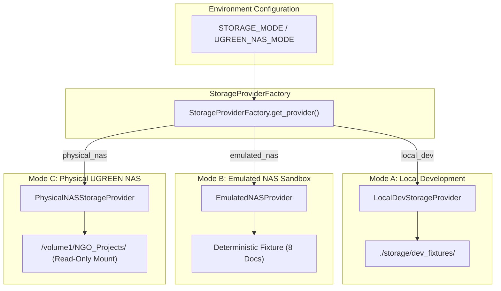

# VaultPilot AI — Round 2 UGREEN NAS Integration Plan & Architecture

**Document Status:** Official Architecture & Integration Specification  
**Author:** Principal Software Architect & UGREEN NAS Integration Specialist  
**Date:** November 10, 2026  
**Repository:** `/home/osama/VaultPilot-AI`  
**Platform Target:** UGREEN AI NAS (UGOS Pro / Debian Linux Kernel / Docker Container Station)

---

## 1. Architectural Overview & The Tri-Mode Pattern

To guarantee strict isolation between development, demonstration, and physical hardware deployment, VaultPilot AI implements a pluggable **Tri-Mode Storage Architecture** managed by `StorageProviderFactory`.



---

## 2. Tri-Mode Operational Specifications

### 2.1 Mode A — Local Development (`StorageMode.LOCAL_DEV`)
- **Intent:** Rapid local development, unit test suites, and CI/CD pipelines.
- **Provider:** `LocalDevStorageProvider` (inherits from `FilesystemNASProvider`).
- **Storage Target:** `./storage/dev_fixtures` (or custom test directory). Automatically created if missing.
- **Characteristics:**
  - Fully isolated from any external NAS hardware.
  - Generates and reads deterministic synthetic test fixtures (PDF, CSV, TXT, JSON).
  - Validates path confinement and parsing logic with fast turnaround.

### 2.2 Mode B — Emulated NAS (`StorageMode.EMULATED_NAS`)
- **Intent:** Offline competition judging, Devpost walkthroughs, and visual demonstrations.
- **Provider:** `EmulatedNASProvider`.
- **Storage Target:** Simulated `/volume1/NGO_Projects/Water_Health_2026`.
- **Characteristics:**
  - Zero filesystem dependencies; returns a stable deterministic array of 8 NGO financial documents.
  - Reproduces realistic audit findings:
    - 3-Way Match (`PO-2026-081` == `INV-SP-1092` == `REC-BNK-993` at $8,500.00).
    - Overbilling Variance (`PO-MED-441` at $12k vs `INV-MED-7712` at $14.5k).
    - Missing Disbursement Voucher (`INV-UNSUPP-902` at $2,400.00).
    - Degraded Blurry Scan (`IMG_7781_blurry.jpg` classified as `UNVERIFIED`).
  - Transparently identifies emulation in the UI (`CURRENT STATUS: OFFLINE LOCAL EMULATION`, `Uliya v0.7.3 EMULATED`).

### 2.3 Mode C — Physical UGREEN NAS (`StorageMode.PHYSICAL_NAS`)
- **Intent:** Real execution on physical UGREEN AI NAS hardware (`iDX6011 Pro` / UGOS Pro).
- **Provider:** `PhysicalNASStorageProvider`.
- **Storage Target:** Configured NAS storage root (e.g. `/volume1/NGO_Projects`).
- **Strict Invariants:**
  1. **Strictly Read-Only:** Files are opened exclusively with `rb` flags. Zero write, rename, move, or unlink calls are made to original evidence.
  2. **Storage Root Verification:** Before scanning, the provider verifies that the physical mount actually exists. If unmounted or offline, raises `NASStorageUnavailableError` (HTTP 503) rather than silently returning mock data.
  3. **Path Traversal & Symlink Defense:** Resolves canonical realpaths, verifies that paths stay within `nas_root`, and blocks symlinks pointing to external volumes or system directories (`/etc`, `/proc`).
  4. **Special File Defense:** Explicitly rejects FIFOs, Unix domain sockets, and character/block devices.
  5. **DoS & Resource Bounding:**
     - `MAX_DISCOVERY_FILES`: Bounded to 500 files per scope to prevent memory exhaustion.
     - `MAX_DISCOVERY_DEPTH`: Recursion capped at 5 directory levels.
     - `MAX_FILE_SIZE_BYTES`: Pre-extraction check rejects files > 25 MB.
  6. **TOCTOU Defense:** Checks file size and modification timestamps (`st_mtime_ns`) before and after hashing to detect concurrent mutation.

---

## 3. Configuration & Environment Variables

| Variable | Type | Default | Permitted Values | Description |
| :--- | :---: | :---: | :---: | :--- |
| `STORAGE_MODE` | String | `emulated_nas` | `local_dev`, `emulated_nas`, `physical_nas` | Selects the active operational storage provider. |
| `UGREEN_NAS_MODE` | String | `emulated` | `real`, `emulated` | Legacy switch mapped directly to `StorageMode` for backward compatibility. |
| `UGREEN_NAS_ROOT` | String | `/volume1/NGO_Projects` | Absolute POSIX Path | Root directory of the authorized NAS grant evidence volume. |
| `LOCAL_DEV_ROOT` | String | `./storage/dev_fixtures` | Relative or Absolute Path | Storage root for local developer fixtures (Mode A). |
| `MAX_DISCOVERY_FILES` | Integer | `500` | $10 \dots 5000$ | Hard safety cap on discovered documents per audit scope. |
| `MAX_DISCOVERY_DEPTH` | Integer | `5` | $1 \dots 10$ | Maximum directory recursion depth beneath target folder. |
| `MAX_FILE_SIZE_BYTES` | Integer | `26214400` (25 MB) | Up to $100\text{ MB}$ | Maximum permissible file size for text/PDF parsing. |

---

## 4. UGOS Pro Container Station Deployment Plan

When deploying VaultPilot AI onto physical UGREEN NAS hardware in Round 2, the application runs inside UGOS Pro Container Station (Docker Engine).

### 4.1 Production `docker-compose.nas.yml`
```yaml
version: '3.8'

services:
  vaultpilot-backend:
    image: vaultpilot-backend:round2-latest
    container_name: vaultpilot-backend
    restart: unless-stopped
    user: "1000:1000" # Non-root unprivileged NAS user
    read_only: true # Read-only container rootfs
    security_opt:
      - no-new-privileges:true
    cap_drop:
      - ALL
    environment:
      - STORAGE_MODE=physical_nas
      - UGREEN_NAS_MODE=real
      - UGREEN_NAS_ROOT=/volume1/NGO_Projects
      - DATABASE_URL=sqlite:////vaultpilot_data/vaultpilot.db
      - MAX_DISCOVERY_FILES=500
      - MAX_DISCOVERY_DEPTH=5
    volumes:
      # STRICT READ-ONLY BIND MOUNT OF NAS STORAGE VOLUME
      - type: bind
        source: /volume1/NGO_Projects
        target: /volume1/NGO_Projects
        read_only: true
      # PERSISTENT DATABASE & AUDIT LEDGER (Writable internal storage)
      - type: volume
        source: vaultpilot_data
        target: /vaultpilot_data
      # TEMP STORAGE FOR SAFE INGESTION (In-memory tmpfs)
      - type: tmpfs
        target: /tmp
        tmpfs:
          size: 64M
          mode: 1777
    ports:
      - "8000:8000"
    healthcheck:
      test: ["CMD", "curl", "-f", "http://localhost:8000/api/v1/projects"]
      interval: 30s
      timeout: 5s
      retries: 3

  vaultpilot-frontend:
    image: vaultpilot-frontend:round2-latest
    container_name: vaultpilot-frontend
    restart: unless-stopped
    user: "1000:1000"
    ports:
      - "5173:80"
    depends_on:
      - vaultpilot-backend

volumes:
  vaultpilot_data:
    driver: local
```

### 4.2 Security & Isolation Verification
- **Container `read_only: true`:** The application container filesystem is immutable. Temporary writes are constrained to a 64MB `tmpfs`.
- **Storage Volume `read_only: true`:** The bind-mount `/volume1/NGO_Projects` is mounted with the Linux kernel `ro` flag. Even if the application were compromised, write or delete operations on original documents are rejected by the operating system kernel.
- **Unprivileged UID/GID:** Operates under standard UID 1000 with `no-new-privileges:true`, completely preventing root escalation on the host NAS.

---

## 5. Physical NAS Hardware Validation Protocol (Nov 22–28)

When physical hardware access is granted in Round 2, the following verification checklist will be executed sequentially:

- [ ] **Step 1: Firmware & Kernel Identification**
  - Run `uname -a` and inspect `/etc/os-release` to record exact UGOS Pro version and kernel build.
- [ ] **Step 2: Volume Mount Inspection**
  - Verify physical mount points using `df -h` and `mount | grep volume1`.
  - Confirm file system type (Btrfs with data integrity checksums or ext4).
- [ ] **Step 3: Uliya Skill Package Installation**
  - Copy `dist/vaultpilot-skill.zip` to the Uliya Skill directory.
  - Verify that the WorkBuddy / Uliya agent registry recognizes `vaultpilot` entry-point.
- [ ] **Step 4: Synthetic Evidence Seeding**
  - Populate `/volume1/NGO_Projects/Test_Grant_2026/` with synthetic PDF invoices, purchase orders, and bank vouchers.
- [ ] **Step 5: Mode C Activation Test**
  - Start VaultPilot backend with `STORAGE_MODE=physical_nas`.
  - Trigger investigation via API: verify `FilesystemNASProvider` scans genuine files without mock injection.
- [ ] **Step 6: TOCTOU & Tamper Test**
  - Attempt modifying a test file mid-hash to verify `NASFileMutationError` triggers.
- [ ] **Step 7: Sealing & Report Verification**
  - Seal an investigation report and confirm SHA-256 hash matches independent calculation on the NAS terminal (`sha256sum report.html`).
